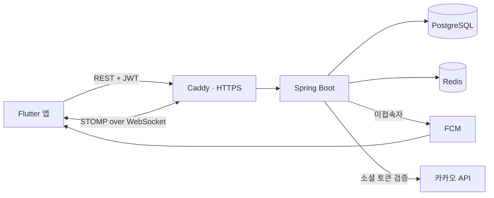

# 툭 (Tuk) — 백엔드

> 친한 친구끼리 **거절 걱정 없이 "지금 볼래?"를 띄우는** 즉흥 만남 앱의 서버.
> 앱(Flutter) 리포: [pyosunyoung/tuk-app](https://github.com/pyosunyoung/tuk-app)

단톡방에 "오늘 저녁 누구 시간 돼?"를 던지고 읽씹당하는 경험에서 시작했습니다.
툭은 **지금 한가한 절친만 보여주고, 한 탭으로 부르고, 거절은 아무에게도 보이지 않게** 만듭니다.

---

## 이 프로젝트에서 봐주셨으면 하는 것

제품 규칙을 **코드 구조로 강제**한 부분입니다. 네 가지 원칙이 있고, 각각이 스키마와 API 설계를 직접 제약합니다.

| 원칙 | 코드에 어떻게 반영했나 |
|---|---|
| **거절이 보이지 않는다** | `FlashRecipient.status` 를 `PENDING`/`JOINED` **두 개로만** 둔다. `DECLINED` 를 넣는 순간 "누가 씹었는지"가 데이터로 남으므로 상태값·API·이벤트 어디에도 만들지 않았다. 무시 = 아무 요청도 보내지 않음 |
| **시간이 지나면 알아서 꺼진다** | presence 는 Redis TTL, 번개는 `expires_at` + `@Scheduled` 스위퍼로 만료. 사용자가 "끄는 것"을 잊어도 상태가 쌓이지 않는다 |
| **합류는 멱등하다** | `FlashRecipient` 에 `UNIQUE(flash_id, user_id)`. 네트워크 재시도로 중복 합류가 생기지 않는다 |
| **대상은 서버가 다시 검증한다** | 번개 발송 시 클라이언트가 보낸 대상 목록을 그대로 믿지 않고 **절친 관계를 서버에서 재확인**한다. 닫힌 절친 그룹이 제품의 전제라서 |

그 외 설계에서 신경 쓴 지점:

- **친구관계 유니크를 정규화 쌍으로** — `(requester, addressee)` 에 유니크를 걸면 방향이 달라 A→B, B→A 중복이 통과한다. 방향은 수락 권한 판단용으로 보존하되 유니크는 `(min(id), max(id))` 에 건다. 경합은 `saveAndFlush` + 제약 위반을 400 으로 번역해 처리
- **refresh 토큰 rotation 을 Redis Lua 로 원자 처리** — 비교→교체를 한 번에 수행해, 같은 토큰으로 동시 요청이 와도 하나만 성공하고 나머지는 재사용 탐지로 걸린다
- **실시간 알림 라우팅을 접속 여부로 분기** — 같은 이벤트를 두 리스너가 나눠 받아 접속자는 WebSocket, 미접속자는 FCM 으로 보낸다. 둘 다 `AFTER_COMMIT` 이라 롤백 시 유령 알림이 나가지 않는다
- **presence 는 의도적으로 푸시하지 않는다** — 앱을 열면 보이는 주변 상태라 푸시하면 시끄럽다. 번개 초대·합류만 푸시한다

---

## 기술 스택

- **Spring Boot 4.0.7 / Java 17**, Spring Data JPA, Spring Security + JWT(jjwt)
- **PostgreSQL** (도메인 데이터) · **Redis** (presence TTL, refresh 토큰, 세션 레지스트리)
- **WebSocket(STOMP)** 실시간 · **FCM** 푸시
- **Flyway** 마이그레이션 · **Docker + Caddy** 배포
- 테스트 **82개** (JUnit 5, Mockito, `@DataJpaTest`)

## 아키텍처



요청 흐름은 **Controller → Service → Repository** 3계층이고, 패키지는 계층이 아니라 **도메인별**로 나눴습니다
(`user` / `friendship` / `presence` / `flash` / `notification` / `global`).

**인증**: 앱이 카카오 SDK 로 소셜 토큰을 받아 보내면 → 서버가 카카오에 검증 → 자체 JWT(access 30분 + refresh 14일, rotation) 발급.
WebSocket 은 CONNECT 헤더의 JWT 로 인증합니다.

## 주요 엔드포인트

| 도메인 | 엔드포인트 |
|---|---|
| 인증 | `POST /api/auth/login` · `/refresh` · `/logout` |
| 내 정보 | `GET /api/users/me` |
| 친구 | `POST /api/friendships` · `POST /{id}/accept` · `GET /requests` · `GET /api/friendships` · `GET /invite-code` · `POST /redeem` |
| Presence | `POST`/`DELETE /api/presence` · `GET /me` · `GET /friends` |
| 번개 | `POST /api/flashes` · `GET /received` · `GET /sent` · `POST /{id}/join` · `GET /{id}/room` · `PATCH /{id}/room/place` |
| 기기토큰 | `POST`/`DELETE /api/device-tokens` |
| 실시간 | `/ws` 핸드셰이크 → 구독 `/user/queue/presence`, `/user/queue/flash` |

전체 요청·응답 형태는 [docs/API_FOR_APP.md](docs/API_FOR_APP.md) 에 정리돼 있습니다(앱과의 계약서).

---

## 실행

### 로컬 개발

```bash
docker compose up -d      # PostgreSQL + Redis
./gradlew bootRun         # 기본 프로필이 dev
```

dev 프로필에서는 `DevSocialClient` 가 열려 있어 카카오 없이 로그인됩니다:

```bash
curl -X POST localhost:8080/api/auth/login \
  -H 'Content-Type: application/json' \
  -d '{"provider":"dev","token":"alice"}'
```

API 문서: `http://localhost:8080/swagger-ui.html`

### 운영 배포

```bash
cp .env.example .env      # DB 비번, JWT 시크릿, 도메인 등
docker compose -f docker-compose.prod.yml up -d --build
```

`Caddy(443) → app(8080) → postgres·redis` 구성이고, Caddy 가 Let's Encrypt 인증서를 자동 발급·갱신합니다.
운영 프로필에서는 Swagger·dev 로그인이 닫히고, CORS 는 지정한 오리진만 통과합니다.

> **`TZ=Asia/Seoul` 이 중요합니다.** 번개 만료가 서버 벽시계(`LocalDateTime`) 기준이라 UTC 컨테이너에서 돌리면 만료 시각이 9시간 어긋납니다.

## 테스트

```bash
./gradlew test    # 82개
```

서비스 계층은 Mockito 로, 레포지토리는 `@DataJpaTest` + 실제 PostgreSQL 로 검증합니다
(제약조건·네이티브 쿼리를 H2 로 대체하면 실제와 달라지는 부분이 있어서).

## 검증 상태

- 카카오 로그인: **카카오계정·카카오톡 앱 로그인 양쪽 실기기 검증** (Galaxy S25)
- FCM: 앱 종료 상태에서 번개 발송 → 푸시 도착 → 탭 시 해당 화면 진입까지 실기기 검증
- STOMP: 에뮬레이터 2대로 presence·번개 실시간 전파 확인
- 배포: Docker + Caddy 구성 완료, 서버 반영 예정

## 문서

- [docs/API_FOR_APP.md](docs/API_FOR_APP.md) — 앱과의 API 계약서
- [CLAUDE.md](CLAUDE.md) — 설계 원칙, 기술 결정, 배포 체크리스트
- 앱 리포의 `docs/DEV_LOG.md` — 기능별 개발 기록(의사결정과 그 이유)
