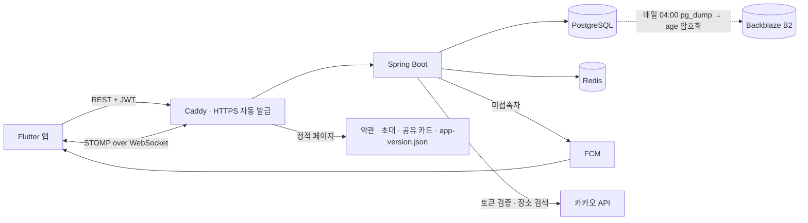

# 툭 (Tuk) — 백엔드

> 친한 친구끼리 **거절 걱정 없이 "지금 볼래?"를 던지는** 즉흥 만남 앱의 서버.
> 앱(Flutter) 리포: [pyosunyoung/tuk-app](https://github.com/pyosunyoung/tuk-app)

단톡방에 "오늘 저녁 누구 시간 돼?"를 던지고 읽씹당하는 경험에서 시작했습니다.
툭은 **지금 한가한 친한 친구만 보여주고, 한 탭으로 부르고, 거절은 아무에게도 보이지 않게** 만듭니다.

- **운영 중**: Vultr 서울 VM 한 대 · Docker Compose · Caddy 자동 HTTPS (2026-09-15 배포)
- **배포**: `main` 에 push → GitHub Actions 가 테스트 → 이미지 → 배포 → health 확인 → 실패 시 자동 롤백
- **테스트 137개** · Flyway 마이그레이션 V1 ~ V5 · 매일 백업(암호화 외부 사본) · 서버/백업 감시

---

## 이 프로젝트에서 봐주셨으면 하는 것

### 1. 제품 원칙을 코드 구조로 강제했다

| 원칙 | 코드에 어떻게 반영했나 |
|---|---|
| **거절이 보이지 않는다** | `FlashRecipient.status` 를 `PENDING`/`JOINED` **두 개로만** 둔다. `DECLINED` 를 넣는 순간 "누가 씹었는지"가 데이터로 남는다. 받은 친구 신청을 지우는 **"거절" API 도 일부러 만들지 않았다** — 상대의 "보낸 신청"에서 사라져 거절이 드러나기 때문 |
| **시간이 지나면 알아서 꺼진다** | 한가함은 Redis TTL, 툭은 `expires_at` + `@Scheduled` 스위퍼. 단 **합류 마감 ≠ 모임 종료** — 성사된 모임은 약속 시간까지, 시간이 없으면 마감 후 6시간 남긴다. 이 규칙은 `MeetupLifecycle` 한 곳에만 두고 응답의 `visibleUntil` 로 앱에 내려준다 |
| **합류는 멱등하다** | `UNIQUE(flash_id, user_id)`. 재시도로 중복 합류가 생기지 않는다 |
| **대상은 서버가 다시 검증한다** | 클라이언트가 보낸 대상 목록을 믿지 않고 친구 관계를 서버에서 재확인한다 |

### 2. 실시간 알림을 접속 여부로 나눠 보낸다

같은 이벤트를 두 리스너가 나눠 받아 **접속자는 WebSocket(STOMP), 미접속자는 FCM** 으로 보낸다. 둘 다 `@TransactionalEventListener(AFTER_COMMIT)` 이라 롤백되면 유령 알림이 나가지 않는다.
알림 종류: 새 툭 · 합류 · 장소/약속 시간 "정해졌어요 / 바뀌었어요"(정한 본인 제외, 같은 값 재저장은 무시) · 친구 신청/수락. 한가함 켜기는 일부러 푸시하지 않는다(시끄럽다).

### 3. 실제로 운영하며 잡은 것들

| 문제 | 한 일 | 결과 |
|---|---|---|
| CI 첫 실행이 `exit 126` | Windows 커밋은 실행 권한이 안 남는다 → `git update-index --chmod=+x` | 이후 CI 초록 |
| 배포 키가 아무 명령이나 실행 가능 | `authorized_keys` 에 `restrict,command=` 로 **배포 스크립트만** 실행되게 | 셸·scp·포워딩 불가(실검증) |
| SSH 비밀번호 대입 하루 6,454회 | 비밀번호 로그인 금지, root 는 키로만. cloud-init 설정보다 먼저 읽히게 파일명 `00-` | 공격 차단 |
| 초대 코드 무차별 대입 가능 | Redis `INCR` + 첫 실패에만 `EXPIRE` 로 **틀린 시도만** 센다 | 10분 10회 초과 시 429 |
| 탈퇴 시 외래키 위반 위험 | CASCADE 없는 스키마에서 자식 → 부모 벌크 삭제를 한 트랜잭션으로 | 실제 DB 통합 테스트. **삭제 한 줄을 빼면 실패**하는 것까지 확인 |
| 제약 이름이 DB 마다 달라 마이그레이션 실패 | 이름 대신 `pg_constraint` 에서 **내용으로 찾아** 교체(V5) | 테스트 13개 실패 → 137개 통과 |
| 백업이 운영 서버 디스크에만 | `age` 공개 키로 암호화 → Backblaze B2, **복호화 키는 서버에 두지 않음** | B2 에서 받아 임시 DB 복원, 운영과 행 수 일치 |

---

## 기술 스택

- **Spring Boot 4.0.7 / Java 17**, Spring Data JPA, Spring Security + JWT(jjwt)
- **PostgreSQL** (도메인) · **Redis** (한가함 TTL, refresh 토큰, 세션 레지스트리, 시도 횟수 제한)
- **WebSocket(STOMP)** 실시간 · **FCM** 푸시 · **카카오** 로그인 / 로컬(장소 검색) API
- **Flyway** · **Docker Compose + Caddy** · **GitHub Actions + GHCR**
- 운영 보조: Backblaze B2(백업 사본) · UptimeRobot(서버 감시) · healthchecks.io(백업 감시)

## 아키텍처



요청 흐름은 **Controller → Service → Repository**, 패키지는 **도메인별**(`user` / `friendship` / `presence` / `flash` / `notification` / `place` / `global`).

**인증**: 앱이 카카오 SDK 로 받은 토큰을 서버가 카카오에 검증 → 자체 JWT(access 30분 + refresh 14일). refresh 는 **Redis Lua 로 원자적 rotation** 이라 같은 토큰으로 동시에 와도 하나만 성공한다. WebSocket 은 CONNECT 헤더의 JWT 로 인증.

**장소 검색**은 서버가 카카오 로컬 API 를 대신 호출한다 — REST 키를 앱에 넣으면 APK 에서 누구나 꺼내 쓸 수 있어서.

## 주요 엔드포인트

| 도메인 | 엔드포인트 |
|---|---|
| 인증 | `POST /api/auth/login` · `/refresh` · `/logout` |
| 내 정보 | `GET /api/users/me` · `DELETE /api/users/me`(탈퇴) |
| 친구 | `GET /api/friendships` · `GET /invite-code` · `POST /redeem` · `POST /{id}/accept` · `GET /requests` · `GET /requests/sent` · `DELETE /requests/{id}`(보낸 신청 취소) · `DELETE /friends/{userId}`(끊기) |
| 한가함 | `POST`/`DELETE /api/presence` · `GET /me` · `GET /friends` |
| 툭 | `POST /api/flashes` · `GET /received` · `GET /sent` · `POST /{id}/join` · `GET /{id}/room` · `PATCH /{id}/room/place` · `PATCH /{id}/room/time` |
| 장소 | `GET /api/places/search?query=` |
| 기기 토큰 | `POST`/`DELETE /api/device-tokens` |
| 실시간 | `/ws` → 구독 `/user/queue/presence`, `/user/queue/flash` |

요청·응답 형태와 이벤트 목록은 [docs/API_FOR_APP.md](docs/API_FOR_APP.md)(앱과의 계약서).

---

## 실행

### 로컬 개발

```bash
docker compose up -d      # PostgreSQL + Redis
./gradlew bootRun         # 기본 프로필 dev
```

dev 프로필에선 `DevSocialClient` 로 카카오 없이 로그인된다(운영에선 401):

```bash
curl -X POST localhost:8080/api/auth/login \
  -H 'Content-Type: application/json' \
  -d '{"provider":"dev","token":"alice"}'
```

### 운영 배포

`main` 에 push 하면 끝이다(문서만 바뀐 커밋은 건너뜀). 서버에서 빌드하지 않는다 — 2GB VM 에서 Gradle 이 돌면 앱과 메모리를 다툰다.

```
test(PG·Redis 서비스 컨테이너) → image(GHCR) → deploy(SSH 강제 명령) → health 180초 대기 → 실패 시 직전 이미지로 롤백
```

> **`TZ=Asia/Seoul` 이 중요하다.** 만료가 서버 벽시계 기준이라 UTC 컨테이너면 9시간 어긋난다.

운영 절차(롤백·백업 복구 명령)는 [CLAUDE.md](CLAUDE.md) "운영 기동 방법".

## 테스트

```bash
./gradlew test    # 137개
```

서비스는 Mockito, 레포지토리·탈퇴·마이그레이션은 **실제 PostgreSQL**(`@DataJpaTest` / `@SpringBootTest`)로 검증한다. 제약조건·네이티브 쿼리를 H2 로 대신하면 실제와 달라져서다.

## 문서

| 문서 | 내용 |
|---|---|
| [docs/FEATURE_NOTES_2026-07-03_07-28_backend.md](docs/FEATURE_NOTES_2026-07-03_07-28_backend.md) | 백엔드 MVP 0 → 1 (인증 · 친구 · 한가함 · 툭 · 실시간 · FCM) |
| [docs/FEATURE_NOTES_2026-07-30_08-27_backend.md](docs/FEATURE_NOTES_2026-07-30_08-27_backend.md) | 앱 API 계약서 · 초대코드 · 내가 던진 툭 조회 |
| [docs/OPS_NOTES_2026-09.md](docs/OPS_NOTES_2026-09.md) | 배포 준비 — Flyway · 운영 프로필 · 배포처 선정 · Docker · Caddy |
| 앱 리포 [`docs/FEATURE_NOTES_*`](https://github.com/pyosunyoung/tuk-app/tree/main/docs) | 09월 이후 기능과 운영(배포 · CI/CD · 백업 · 모니터링)을 기간별로 |
| [docs/API_FOR_APP.md](docs/API_FOR_APP.md) | 앱과의 API 계약서 |
| [CLAUDE.md](CLAUDE.md) | 설계 원칙, 운영 절차, 배포 체크리스트 |

각 정리본은 **배경 → 선정 이유 → 구현 → Before/After(캡처·수치) → 테스트 → 남은 과제** 순서로 썼다.
