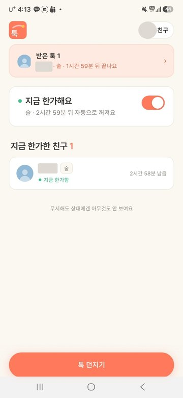
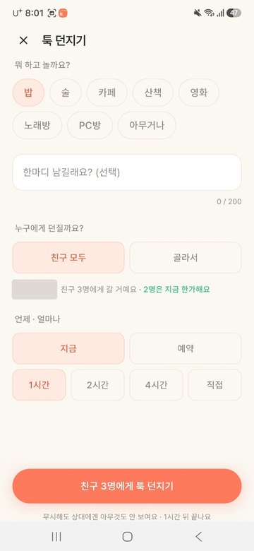
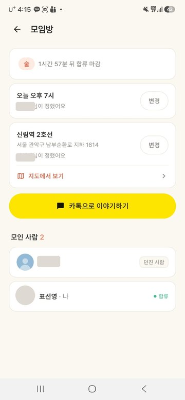
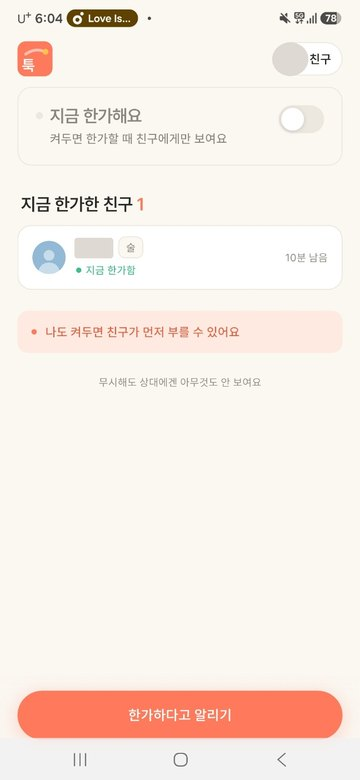
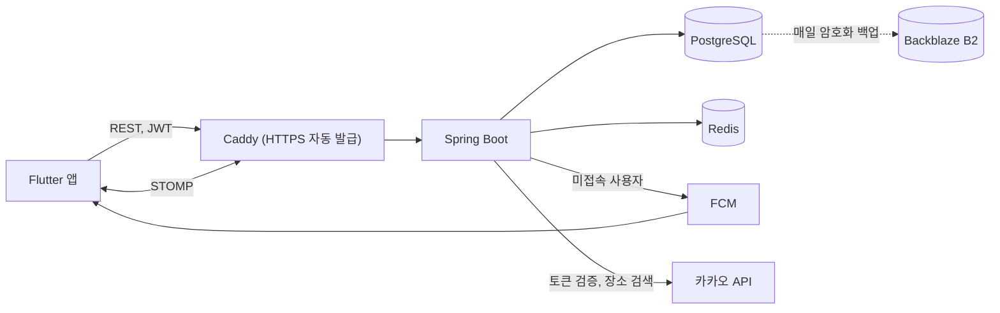
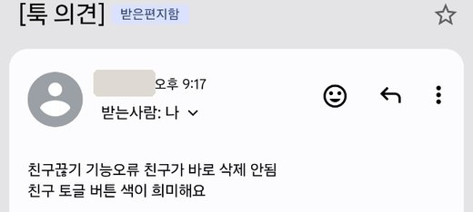

# 툭 (Tuk) 백엔드 서버

친한 친구끼리 거절 부담 없이 "지금 볼래?"를 던지는 즉흥 만남 앱의 서버입니다.

기획, 서버, 앱, 인프라까지 1인으로 개발해 운영 중입니다. 실시간 알림, 토큰 동시성, 데이터 무결성을 실제 DB와 Redis로 검증했고, 자동 배포와 롤백, 암호화 백업, 감시까지 직접 구성했습니다.

<table>
<tr><td align="center" valign="top"><br>툭을 받은 홈</td><td align="center" valign="top"><br>툭 던지기</td><td align="center" valign="top"><br>모임방</td><td align="center" valign="top"><br>지금 한가한 친구</td></tr>
</table>

- **역할**: 1인 개발 (기획, 서버, 앱, 인프라)
- **스택**: Spring Boot 4, Java 17, JPA, PostgreSQL, Redis, WebSocket(STOMP), FCM, Flyway
- **인프라**: Vultr 서울 VM, Docker Compose, Caddy, GitHub Actions, GHCR, Backblaze B2
- **운영**: 2026년 9월부터 운영 중, 월 $10
- **테스트**: 149개, 실제 PostgreSQL과 Redis 통합 테스트 포함, 실패하면 배포되지 않음
- **앱 리포**: [pyosunyoung/tuk-app](https://github.com/pyosunyoung/tuk-app) (전체 화면과 실사용 기록)

## 아키텍처



## 핵심 문제 해결

### 1. Refresh Token 교체의 동시성

- **문제**: 읽기, 비교, 쓰기를 따로 실행하면 같은 토큰으로 동시에 온 요청이 모두 통과합니다. 토큰이 여러 개 발급되고 탈취 탐지도 무력화됩니다.
- **해결**: 비교와 교체, 파기를 Redis Lua 스크립트 하나로 묶었습니다. 앱은 동시 401을 refresh 1회로 합쳐 정상 사용자가 재사용 탐지에 걸리지 않게 했습니다.
- **검증**: 실제 Redis에 같은 토큰으로 동시 요청을 보냅니다. Lua 구현은 8건 중 교체 1건, 비원자 구현으로 바꾸면 8건 모두 교체되어 테스트가 실패합니다.

```lua
local cur = redis.call('get', KEYS[1])
if not cur then return -1 end
if cur == ARGV[1] then
  redis.call('set', KEYS[1], ARGV[2], 'PX', ARGV[3])
  return 1
end
redis.call('del', KEYS[1])
return 0
```

코드: [RedisRefreshTokenStore.java](src/main/java/com/tuk/global/auth/token/RedisRefreshTokenStore.java), [RedisRefreshTokenStoreTest.java](src/test/java/com/tuk/global/auth/token/RedisRefreshTokenStoreTest.java)

### 2. 커밋된 사건만, 받을 수 있는 경로로 알림

- **문제**: 트랜잭션 안에서 알림을 보내면 롤백돼도 알림이 나갑니다. 접속 중인 사용자와 아닌 사용자의 전달 경로도 다릅니다.
- **해결**: 서비스는 이벤트만 발행하고, `AFTER_COMMIT` 리스너 두 개가 접속자에게 STOMP, 미접속자에게 FCM으로 보냅니다. 커밋 이후 만료 토큰을 삭제하는 작업은 `REQUIRES_NEW`로 분리했습니다.
- **소음 관리**: 정한 본인을 제외하고, 같은 값을 다시 저장하면 알리지 않으며, 한가함 켜기는 푸시하지 않습니다.

```java
@TransactionalEventListener(phase = TransactionPhase.AFTER_COMMIT)
public void onFlashBroadcast(FlashBroadcastEvent event) {
    for (Long targetId : event.targetUserIds()) {
        if (sessionRegistry.isOnline(targetId)) {
            messagingTemplate.convertAndSendToUser(String.valueOf(targetId), DESTINATION, event.payload());
        }
    }
}
```

(전송 실패를 대상별로 격리하는 처리는 생략한 발췌입니다.)

코드: [FlashEventBroadcaster.java](src/main/java/com/tuk/flash/ws/FlashEventBroadcaster.java), [FlashPushListener.java](src/main/java/com/tuk/notification/service/FlashPushListener.java), [PushNotificationService.java](src/main/java/com/tuk/notification/service/PushNotificationService.java)

### 3. 비즈니스 규칙을 서버 한 곳으로 통합

- **문제**: 모임 노출 기간의 조건을 고칠 때마다 다른 버그가 나왔습니다. 합류할 수 없는 초대가 남고, 혼자인 모임이 남고, 시간을 정하지 않은 모임이 사라졌습니다. 앱도 같은 판단을 따로 하고 있었습니다.
- **해결**: 규칙을 [`MeetupLifecycle`](src/main/java/com/tuk/flash/domain/MeetupLifecycle.java)로 모으고 응답의 `visibleUntil`로 내려줍니다. 앱은 이 값만 따릅니다.
- **검증**: 6시간 경계를 받은 쪽과 보낸 쪽에서 각각 테스트합니다. 리포지토리 슬라이스 테스트가 만료된 툭이 목록에 섞이는 쿼리 오류를 배포 전에 잡았습니다.

### 4. 제품 원칙을 데이터 모델로 강제

- **거절이 보이지 않음**: 수신 상태는 `PENDING`, `JOINED` 두 개뿐입니다. `DECLINED`와 거절 API를 일부러 만들지 않아 거절 기록 자체가 남지 않습니다.
- **멱등 합류**: `UNIQUE(flash_id, user_id)`로 재시도해도 중복 합류가 생기지 않습니다.
- **친구 관계 중복 방지**: 방향과 무관한 정규화 쌍에 UNIQUE를 걸고, 경합으로 인한 예외는 400으로 변환합니다.
- **대상 재검증**: 앱이 보낸 대상을 믿지 않고 서버에서 친구 관계를 다시 확인합니다.

### 5. 데이터 정합성과 쿼리

- **탈퇴**: 외래키에 CASCADE가 없어 자식부터 부모 순으로 한 트랜잭션에서 삭제합니다. 삭제 한 줄을 빼면 외래키 위반으로 실패하는 실제 DB 테스트로 순서를 고정했습니다. ([AccountDeletionServiceTest.java](src/test/java/com/tuk/user/service/AccountDeletionServiceTest.java))
- **N+1**: 툭 목록의 수신자 조회를 IN 쿼리 한 번으로 바꿨습니다. 툭 20개 기준 쿼리 21회가 1회로 줄었고 Hibernate Statistics로 측정했습니다.
- **마이그레이션**: 같은 제약의 이름이 DB마다 달라 실패한 마이그레이션을 `pg_constraint`에서 정의로 찾아 교체하도록 수정했습니다. ([V5](src/main/resources/db/migration/V5__activity_pc_room.sql))

### 6. 보안

- **카카오 토큰 발급 앱 확인**: 다른 카카오 앱에서 발급된 토큰을 거부합니다. `app_id`를 비교하고, 설정이 비어 있으면 경고만 남겨 배포 순서로 로그인이 막히지 않게 했습니다. ([KakaoClient.java](src/main/java/com/tuk/global/auth/social/KakaoClient.java))
- **초대 코드 대입 방지**: 틀린 시도만 Redis로 세어 10분에 10회를 넘으면 429로 응답합니다. ([InviteCodeAttemptLimiter.java](src/main/java/com/tuk/friendship/service/InviteCodeAttemptLimiter.java))
- **운영 프로필**: Swagger, 개발용 로그인, health 외 actuator를 차단하고 허용 오리진만 CORS를 통과시킵니다.
- **키 관리**: 카카오 REST 키는 서버에만 두고 장소 검색을 서버가 대신 호출합니다.

## 운영

```
test      PostgreSQL, Redis 서비스 컨테이너로 전체 테스트
image     GHCR에 커밋 SHA 태그로 저장
deploy    SSH 강제 명령으로 배포 스크립트 실행
health    최대 180초 상태 확인
rollback  실패하면 직전 이미지로 자동 복구
```

| 영역 | 구성 | 결과 |
|---|---|---|
| 배포 | main push 시 자동, 서버는 이미지만 받음 | 3~5분, 2GB VM 빌드 부담 제거 |
| 배포 키 | `restrict,command=`로 배포 스크립트만 허용 | 셸, 파일 복사, 포워딩 불가 확인 |
| SSH | 비밀번호 로그인 차단, 키 전용 | 비밀번호 실패 하루 5,855건에서 0건 |
| 백업 | 매일 `pg_dump`, `age` 암호화, B2 30일 보관 | B2 사본 복원, 운영과 행 수 일치 |
| 감시 | UptimeRobot 5분, healthchecks.io | 서버 장애와 백업 미실행을 메일로 인지 |
| 로그 | 볼륨에 파일 저장, 30일, 300MB 상한 | 배포 후에도 로그 유지 |
| 자원 | 컨테이너별 메모리 상한 | app 1GB, DB 384MB, Redis 192MB, Caddy 96MB |

코드: [backend.yml](.github/workflows/backend.yml), [tuk-deploy](ops/deploy/tuk-deploy), [tuk-db-backup](ops/backup/tuk-db-backup), [00-tuk-hardening.conf](ops/ssh/00-tuk-hardening.conf), [docker-compose.prod.yml](docker-compose.prod.yml)

## 실사용 검증

2026년 10월 22일부터 25일까지 지인 3명과 실제 폰 4대로 사용했습니다. 툭 9건, 합류 12건, 해당 기간 서버 에러 로그 0건입니다. 아래는 상대 폰 잠금화면에 도착한 실제 알림입니다. 다른 사람의 이름은 가렸습니다.

<table>
<tr><td></td><td></td></tr>
<tr><td></td><td></td></tr>
</table>

### 사용자 의견을 반영한 수정



- **문제**: 친구 끊기는 상대에게 알리지 않으려고 이벤트를 보내지 않았습니다. 끊긴 쪽은 앱을 다시 열 때까지 끊은 사람을 친구 목록과 툭 대상에서 계속 봤고, 취소된 신청을 수락하면 404가 발생했습니다.
- **해결**: 알림 이벤트와 분리한 `FriendsChangedEvent`를 발행합니다. 커밋 뒤 상대가 접속 중이면 `/user/queue/friends`로 갱신 신호만 보냅니다. 화면에 표시되지 않는 신호라 FCM은 쓰지 않습니다.
- **호환성**: 옛 앱은 이 주소를 구독하지 않아 서버를 먼저 배포해도 안전합니다.

코드: [FriendsChangedBroadcaster.java](src/main/java/com/tuk/friendship/ws/FriendsChangedBroadcaster.java)

전체 화면과 사용 기록은 [앱 리포 README](https://github.com/pyosunyoung/tuk-app#%EC%8B%A4%EC%82%AC%EC%9A%A9-%EA%B2%80%EC%A6%9D)에 있습니다.

## API

- **인증**: `POST /api/auth/login`, `/refresh`, `/logout`
- **내 정보**: `GET`, `DELETE /api/users/me`
- **친구**: `GET /api/friendships`, `/invite-code`, `/requests`, `/requests/sent`
    - `POST /redeem`, `/{id}/accept`
    - `DELETE /requests/{id}`, `/friends/{userId}`
- **한가함**: `POST`, `DELETE /api/presence`, `GET /me`, `/friends`
- **툭**: `POST /api/flashes`, `GET /received`, `/sent`, `/{id}/room`
    - `POST /{id}/join`
    - `PATCH /{id}/room/place`, `/{id}/room/time`
- **장소**: `GET /api/places/search?query=`
- **기기 토큰**: `POST`, `DELETE /api/device-tokens`
- **실시간**: `/ws`, 구독 `/user/queue/presence`, `/user/queue/flash`, `/user/queue/friends`

요청과 응답 형식은 [API_FOR_APP.md](docs/API_FOR_APP.md)에 정리했습니다.

## 실행과 테스트

```bash
docker compose up -d      # PostgreSQL, Redis
./gradlew bootRun         # 기본 프로필 dev
./gradlew test            # 149개 (동시성 20회 반복 포함 168회 실행)
```

서비스 규칙은 Mockito로, 쿼리와 탈퇴, 마이그레이션은 실제 PostgreSQL로 검증합니다. H2는 제약 조건과 네이티브 쿼리 동작이 달라 사용하지 않습니다.

## 현재 한계와 다음 단계

- **무중단 배포**: 재시작 방식이라 배포 중 약 50초 끊깁니다. 다음 단계는 블루그린 배포입니다.
- **수평 확장**: SimpleBroker와 스케줄러가 서버 한 대를 전제로 합니다. 확장 시 외부 브로커와 분산 락으로 교체합니다.
- **부하 테스트**: 동시 접속 한계와 응답 시간은 아직 측정하지 않았습니다.
- **롤백 검증**: 자동 롤백은 실패를 일부러 주입해 확인하지 않았습니다.

## 문서

- [전체 정리 (OVERVIEW)](https://github.com/pyosunyoung/tuk-app/blob/main/docs/OVERVIEW.md)
- 기능 정리: [백엔드 MVP](docs/FEATURE_NOTES_2026-07-03_07-28_backend.md), [앱 API 지원](docs/FEATURE_NOTES_2026-07-30_08-27_backend.md), [배포 준비](docs/OPS_NOTES_2026-09.md)
- 운영 절차와 설계 원칙: [CLAUDE.md](CLAUDE.md)
