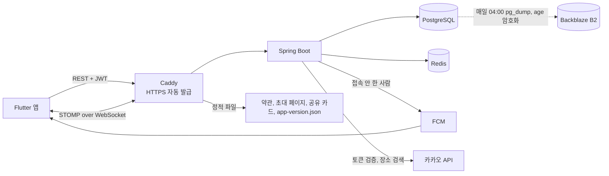

# 툭 (Tuk) 백엔드

> 친한 친구끼리 **거절 걱정 없이 "지금 볼래?"를 던지는** 즉흥 만남 앱의 서버
>
> - 앱(Flutter) 리포: [pyosunyoung/tuk-app](https://github.com/pyosunyoung/tuk-app)
> - 전체 정리(기획, 구조, 부딪힌 문제, 운영, 타임라인): [tuk-app/docs/OVERVIEW.md](https://github.com/pyosunyoung/tuk-app/blob/main/docs/OVERVIEW.md)

단톡방에 "오늘 저녁 누구 시간 돼?"를 던지고 읽씹당하는 경험에서 시작했다.
툭은 **지금 한가한 친한 친구만 보여 주고, 한 탭으로 부르고, 거절은 아무에게도 보이지 않게** 만든다.

- **운영 중**: Vultr 서울 VM 한 대에 Docker Compose로 올리고, Caddy가 HTTPS를 자동으로 발급한다(2026-09-15 배포)
- **배포**: `main`에 push하면 GitHub Actions가 테스트, 이미지 빌드, 배포, health 확인을 하고 실패하면 직전 버전으로 되돌린다
- **품질과 운영**: 테스트 149개, Flyway 마이그레이션 V1 ~ V6, 매일 암호화 백업(서버 밖 사본), 서버와 백업 감시, 앱 로그 30일 보관
- **실사용**: 2026-10-22 ~ 10-25에 지인 3명과 실제 폰 4대로 썼다. 툭 9개, 합류 12번, 툭을 받고 합류까지 **평균 1~2분**, 그 기간 서버 에러 로그 **0건**

친구 폰 잠금화면에 실제로 온 알림이다(새 툭, 합류, 약속 시간 변경, 장소 변경).

<table>
<tr><td></td><td></td></tr>
<tr><td></td><td></td></tr>
</table>

앱 화면 전체와 실사용 기록은 앱 리포 README의 [실사용 기록](https://github.com/pyosunyoung/tuk-app#%EC%8B%A4%EC%82%AC%EC%9A%A9-%EA%B8%B0%EB%A1%9D-2026-10-22--10-25)에 있다.

---

## 이 프로젝트에서 봐 주셨으면 하는 것

### 1. 제품 원칙을 코드 구조로 강제했다

- **거절이 보이지 않는다**: `FlashRecipient.status`는 `PENDING`과 `JOINED` **두 개뿐**이다. `DECLINED`를 넣는 순간 "누가 무시했는지"가 데이터로 남는다. 받은 친구 신청을 지우는 **"거절" API도 일부러 만들지 않았다.** 상대의 "보낸 신청" 목록에서 사라지면서 거절이 드러나기 때문이다.
- **시간이 지나면 알아서 꺼진다**: 한가함은 Redis TTL로, 툭은 `expires_at`과 `@Scheduled` 스위퍼로 만료된다. 다만 **합류 마감과 모임 종료는 다르다.** 성사된 모임은 약속 시간까지 남기고, 시간을 안 정했으면 마감 후 6시간 남긴다. 이 규칙은 `MeetupLifecycle` 한 곳에만 두고, 응답의 `visibleUntil`로 앱에 내려준다.
- **합류는 멱등하다**: `UNIQUE(flash_id, user_id)` 덕분에 재시도해도 중복 합류가 생기지 않는다.
- **대상은 서버가 다시 확인한다**: 앱이 보낸 대상 목록을 그대로 믿지 않고 친구 관계를 서버에서 다시 확인한다.

### 2. 실시간 알림을 접속 여부로 나눠 보낸다

같은 이벤트를 두 리스너가 나눠 받아서 **접속 중인 사람에게는 WebSocket(STOMP)으로, 아닌 사람에게는 FCM으로** 보낸다. 둘 다 `@TransactionalEventListener(AFTER_COMMIT)`라서 롤백되면 알림도 나가지 않는다.

알림 종류는 새 툭, 합류, 장소와 약속 시간의 "정해졌어요 / 바뀌었어요", 친구 신청과 수락이다. 정한 본인에게는 보내지 않고, 같은 값을 다시 저장하면 무시한다. 한가함 켜기는 시끄러워서 일부러 푸시하지 않는다.

### 3. 실제로 운영하며 잡은 것들

| 문제 | 해결 | 결과 |
|---|---|---|
| 첫 CI 실패(exit 126) | 스크립트 실행 권한을 git에 기록 | CI 통과 |
| 배포 키로 아무 명령 실행 | `restrict,command=`로 배포 스크립트만 | 셸, 파일 복사 불가 |
| SSH 비밀번호 대입 공격 | 비밀번호 로그인 끄고 키로만 | 하루 실패 **5,855 → 0** |
| 초대 코드 무차별 대입 | 틀린 시도만 Redis로 셈 | 10분 10회 넘으면 429 |
| 탈퇴 시 외래키 위반 | 자식부터 부모 순으로 삭제 | 실제 DB 테스트 |
| DB마다 다른 제약 이름 | 이름 대신 내용으로 찾아 교체(V5) | 실패 13개 → 0 |
| 백업이 서버 디스크에만 | 암호화해서 B2에 사본 | 복원해 행 수 일치 |
| 카카오 토큰 발급 앱 미확인 | `app_id`를 툭 앱과 비교 | 다른 앱 토큰 401 |
| 초대 코드 중복 허용 | V6 unique index | 실제 DB 테스트 |
| 배포하면 로그가 사라짐 | 볼륨에 로그 파일, 30일 보관 | 배포 뒤에도 확인 가능 |

몇 가지는 설명을 덧붙인다.

- 첫 CI 실패는 Windows에서 커밋한 스크립트에 실행 권한이 남지 않아서였다(`git update-index --chmod=+x`).
- 초대 코드는 Redis `INCR`로 틀린 시도만 세고, 첫 실패에만 `EXPIRE`를 건다. 매번 걸면 10분 창이 계속 밀려 영원히 풀리지 않는다.
- 탈퇴는 외래키에 CASCADE가 없어서 한 트랜잭션 안에서 자식부터 지운다. 삭제 한 줄을 일부러 빼면 테스트가 외래키 위반으로 실패하는 것까지 확인했다.
- SSH 설정은 같은 옵션이 여러 번 나오면 먼저 읽은 값을 쓴다. 클라우드 기본 설정(`50-cloud-init.conf`)이 비밀번호를 허용하고 있어서, 우리 설정 파일 이름을 `00-`으로 시작해 먼저 읽히게 했다. 숫자는 09-15와 10-14의 서버 기록을 하루 단위로 센 값이다.
- 백업 복호화 개인 키는 서버에 두지 않는다. 서버를 잃어도 B2 사본을 풀 수 있고, 서버가 털려도 지난 백업은 풀 수 없다.
- 카카오 앱 ID 설정이 비어 있으면 확인을 건너뛰고 경고만 남긴다. 설정보다 코드가 먼저 배포돼도 운영 로그인이 막히지 않게 하려는 것이다. 비교하는 줄을 빼면 테스트가 실패하는 것까지 확인했다.

### 4. 실사용 의견으로 고친 것 (1.0.1)


"친구 끊기를 해도 바로 삭제 안 됨"이라는 의견을 받았다. 친구 끊기는 상대에게 알리지 않으려고 **아무 이벤트도 보내지 않았다.** 그래서 끊긴 쪽은 앱을 다시 열 때까지 끊은 사람을 친구 목록, 지금 한가한 친구, 툭 보낼 대상에서 계속 봤다. 보낸 신청 취소도 같은 문제라서, 받은 쪽이 남아 있는 신청을 수락하면 404가 났다.

- 끊기와 신청 취소에서 `FriendsChangedEvent`를 발행한다. 알림용 `FriendshipEvent`와는 따로 둔다.
- `FriendsChangedBroadcaster`가 커밋 뒤에 상대가 접속 중일 때만 `/user/queue/friends`로 `{"type":"FRIENDS_CHANGED"}`를 보낸다. 화면에 아무것도 띄우지 않는 데이터 신호라 FCM은 쓰지 않는다. 앱이 꺼져 있으면 다음에 켤 때 어차피 새로 불러온다.
- 옛 앱(1.0.0)은 이 주소를 구독하지 않아서 서버를 먼저 배포해도 안전했다. 앱 1.0.1은 `public/app-version.json` 한 줄을 바꿔 안내했다.

---

## 기술 스택

- **Spring Boot 4.0.7, Java 17**, Spring Data JPA, Spring Security, JWT(jjwt)
- **PostgreSQL**(도메인 데이터), **Redis**(한가함 TTL, refresh 토큰, 시도 횟수 제한)
- **WebSocket(STOMP)** 실시간, **FCM** 푸시, **카카오** 로그인과 로컬(장소 검색) API
- **Flyway**, **Docker Compose**, **Caddy**, **GitHub Actions**, **GHCR**
- 운영 보조: Backblaze B2(백업 사본), UptimeRobot(서버 감시), healthchecks.io(백업 감시)

## 아키텍처



요청은 **Controller, Service, Repository** 순서로 흐르고, 패키지는 **도메인별**로 나눴다(`user`, `friendship`, `presence`, `flash`, `notification`, `place`, `global`).

**인증**: 앱이 카카오 SDK로 받은 토큰을 서버가 카카오에 확인하고 자체 JWT(access 30분, refresh 14일)를 발급한다. 확인할 때 그 토큰이 **툭 앱에서 발급된 것인지(app_id)** 먼저 본다. 다른 카카오 앱의 토큰으로 로그인되는 것을 막기 위해서다. refresh는 **Redis Lua로 원자적으로 교체**해서, 같은 토큰으로 동시에 요청이 와도 하나만 성공한다. WebSocket은 CONNECT 헤더의 JWT로 인증한다.

**장소 검색**은 서버가 카카오 로컬 API를 대신 호출한다. REST 키를 앱에 넣으면 APK를 풀어 누구나 꺼내 쓸 수 있어서다.

## 주요 엔드포인트

- **인증**: `POST /api/auth/login`, `/refresh`, `/logout`
- **내 정보**: `GET /api/users/me`, `DELETE /api/users/me`(탈퇴)
- **친구** (`/api/friendships`)
    - `GET /`, `GET /invite-code`, `POST /redeem`, `POST /{id}/accept`
    - `GET /requests`, `GET /requests/sent`
    - `DELETE /requests/{id}`(보낸 신청 취소), `DELETE /friends/{userId}`(친구 끊기)
- **한가함** (`/api/presence`): `POST`, `DELETE`, `GET /me`, `GET /friends`
- **툭** (`/api/flashes`)
    - `POST /`, `GET /received`, `GET /sent`, `POST /{id}/join`
    - `GET /{id}/room`, `PATCH /{id}/room/place`, `PATCH /{id}/room/time`
- **장소**: `GET /api/places/search?query=`
- **기기 토큰**: `POST`, `DELETE /api/device-tokens`
- **실시간**: `/ws`에 연결한 뒤 `/user/queue/presence`, `/user/queue/flash`, `/user/queue/friends`(친구 관계 변경 신호)를 구독

요청과 응답 형태, 이벤트 목록은 앱과의 계약서 [docs/API_FOR_APP.md](docs/API_FOR_APP.md)에 있다.

---

## 실행

### 로컬 개발

```bash
docker compose up -d      # PostgreSQL + Redis
./gradlew bootRun         # 기본 프로필 dev
```

dev 프로필에서는 `DevSocialClient`로 카카오 없이 로그인할 수 있다(운영에서는 401).

```bash
curl -X POST localhost:8080/api/auth/login \
  -H 'Content-Type: application/json' \
  -d '{"provider":"dev","token":"alice"}'
```

### 운영 배포

`main`에 push하면 끝이다. 문서만 바뀐 커밋은 건너뛴다. 서버에서는 빌드하지 않는다. 2GB VM에서 Gradle이 돌면 운영 중인 앱과 메모리를 다투기 때문이다.

```
test(PG, Redis 서비스 컨테이너) → image(GHCR) → deploy(SSH 강제 명령) → health 180초 대기 → 실패 시 직전 이미지로 롤백
```

> **`TZ=Asia/Seoul`이 중요하다.** 만료를 서버 시계 기준으로 계산해서 UTC 컨테이너면 9시간 어긋난다.

롤백, 백업 복구, 로그 보는 명령은 [CLAUDE.md](CLAUDE.md)의 "운영 기동 방법"과 "앱 로그"에 있다.

## 테스트

```bash
./gradlew test    # 149개 (동시성 테스트 20회 반복을 포함하면 168회 실행)
```

서비스 규칙은 Mockito로, 리포지토리와 탈퇴와 마이그레이션은 **실제 PostgreSQL**(`@DataJpaTest`, `@SpringBootTest`)로 확인한다. 제약 조건과 네이티브 쿼리를 H2로 대신하면 실제와 달라지기 때문이다.

refresh 교체의 원자성도 **실제 Redis에 같은 토큰으로 동시에 요청**해서 교체가 정확히 한 번만 되는지 본다. Lua 대신 읽기, 비교, 쓰기를 따로 하도록 바꾸면 요청 8개에 토큰 8개가 발급되면서 테스트가 실패하는 것까지 확인했다.

## 문서

각 정리본은 **배경, 선정 이유, 구현, 전후 비교(캡처와 수치), 테스트, 남은 과제** 순서로 썼다.

- [백엔드 MVP (07-03 ~ 07-28)](docs/FEATURE_NOTES_2026-07-03_07-28_backend.md): 인증, 친구, 한가함, 툭, 실시간, FCM
- [앱 API 지원 (07-30 ~ 08-27)](docs/FEATURE_NOTES_2026-07-30_08-27_backend.md): 앱 API 계약서, 초대 코드, 내가 던진 툭 조회
- [배포 준비 (09월)](docs/OPS_NOTES_2026-09.md): Flyway, 운영 프로필, 배포처 선정, Docker, Caddy
- [앱 리포 정리본](https://github.com/pyosunyoung/tuk-app/tree/main/docs): 9월 이후 기능과 운영(배포, CI/CD, 백업, 모니터링)
- [API_FOR_APP.md](docs/API_FOR_APP.md): 앱과의 API 계약서
- [CLAUDE.md](CLAUDE.md): 설계 원칙, 운영 절차, 배포 체크리스트
